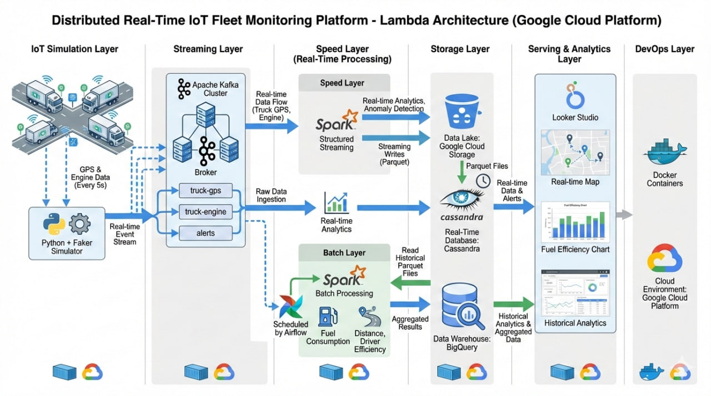

## Project Title

Conception et mise en œuvre d’une plateforme IoT distribuée de suivi en temps réel des véhicules basée sur une architecture Big Data orientée streaming et cloud.

## ARCHITECTURE
### IoT Simulation Layer (Data Generation)
- Tools:

    - Python

    - Faker

    - Custom GPS logic (lat/lon movement algorithm)

    - Docker

- What it does:

    - Simulate 100–500 trucks

    - Send data every 5 seconds

    - Generate:

        - GPS (lat/lon)

        - Speed

        - Fuel level

        - Engine temperature

        - Driver ID

        - Timestamp

    - Inject anomalies (overspeed, overheating, sudden stop)

- This shows:
- ✔ Data modeling
- ✔ Realistic event simulation

### Streaming Layer (Event Ingestion)
- Tool:

    - Apache Kafka

- Why?
- Because Kafka = industry standard for streaming.

- Structure:

- Topics:

    - truck-gps

    - truck-engine

    - alerts

- You demonstrate:
- ✔ Real-time ingestion
- ✔ Event-driven architecture
- ✔ Partitioning & scalability

### Stream Processing Layer
- Tool:

- Apache Spark Structured Streaming

- Why Spark?
- Because it shows distributed processing and Big Data expertise.

- What Spark will do:

- Consume from Kafka

- Clean & validate data

- Compute:

    - Distance traveled

    - Speed violations

    - Fuel consumption rate

    - Engine anomaly detection

- Aggregate per truck

- Generate alerts

- Write to storage

### BATCH LAYER
- Tool:

    - Spark (Batch mode)

    - Airflow (scheduler)

- Storage source:

- Raw historical data stored in:

    - Google Cloud Storage (Parquet files)

- 🔍 What the Batch Layer Will Do

- Every night (or every hour):

- Read historical data from GCS

- Recalculate:

    - Total distance per truck

    - Average fuel consumption per 100km

    - Route efficiency

    - Fuel waste anomalies

    - Maintenance prediction indicators

- Example advanced metrics:

    - Fuel Consumption = (Fuel_start - Fuel_end) / Total_km

    - Efficiency ranking per driver

    - Monthly performance scoring

- Output of Batch Layer:

- Write aggregated results to:

   - Google BigQuery

- This becomes your Analytics Warehouse.

### Storage Layer (Hybrid Architecture – VERY STRONG)

- We will separate storage into 3 parts:

#### A. Data Lake

- Google Cloud Storage (GCS)

- Stores:

    - Raw streaming data (Parquet format)

    - Historical data

- Why?
- Because Data Lake architecture is modern.

#### B. Real-Time Query Layer

- Apache Cassandra

- Stores:

    - Latest truck position

    - Recent telemetry

- Why Cassandra?

    - Distributed

    - High write throughput

    - Good for time-series data

- This shows NoSQL expertise.

#### C. Data Warehouse

- Google BigQuery

- Stores:

    - Aggregated historical data

    - Analytics-ready tables

- Why BigQuery?

    - Serverless

    - Modern

    - Very attractive in interviews

- Now your architecture includes:
- ✔ Data Lake
- ✔ NoSQL DB
- ✔ Cloud Data Warehouse

### Analytics & Visualization Layer
- Tool:

    - Looker Studio (or Metabase)

- Dashboards:

    - Real-time map of trucks

    - Speed violations

    - Fuel efficiency ranking

    - Maintenance prediction alerts

    - Historical trend analysis

- You show decision support (module BI).

### Orchestration Layer (Very Important for Interviews)
- Tool:

- Apache Airflow

- Use it for:

    - Managing batch jobs

    - Data pipeline scheduling

    - Daily aggregation jobs

    - Data quality checks

### DevOps & Deployment
- Tools:

    - Docker

    - Docker Compose

    - GitHub

    - (Optional strong upgrade) Kubernetes

    - (Optional elite) Terraform

- You containerize:

    - Kafka

    - Spark

    - Cassandra

    - Airflow

    - Simulator

- This shows:
- ✔ Production mindset
- ✔ Microservices architecture

