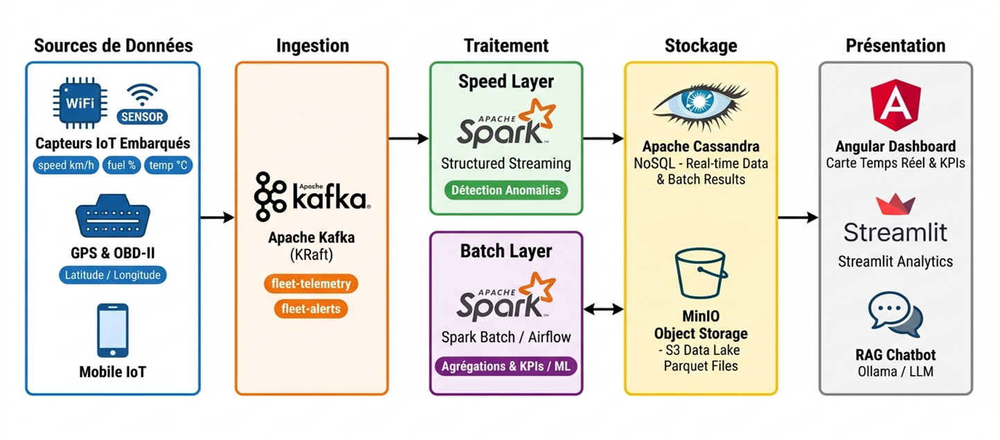
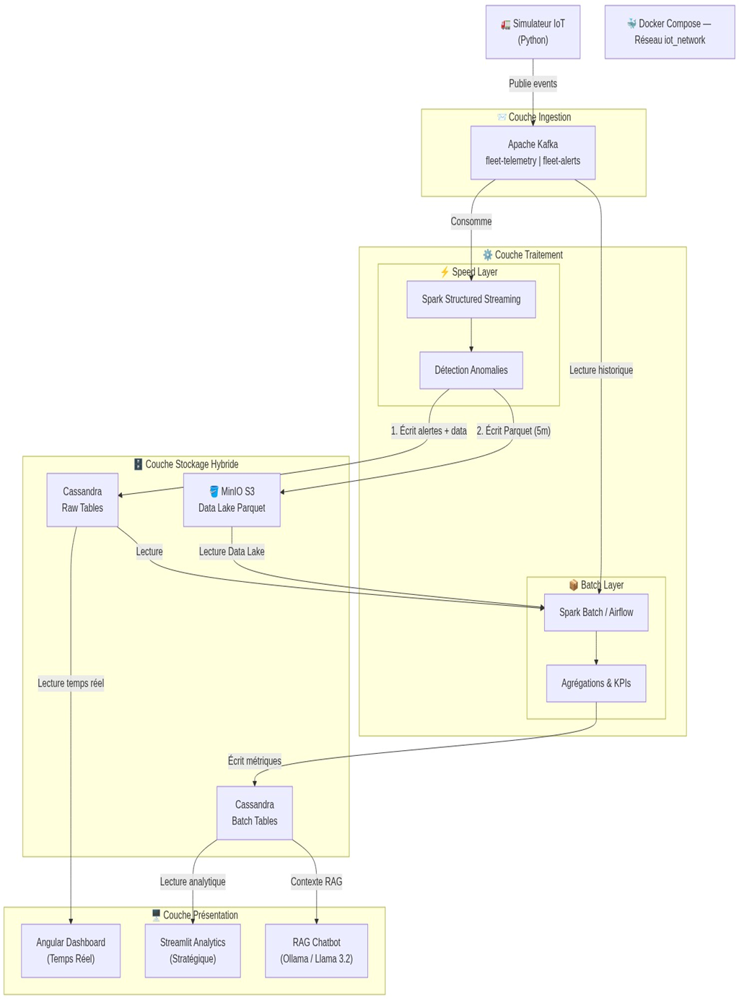
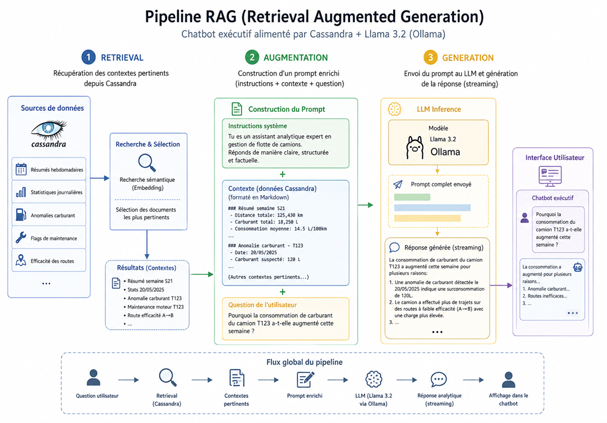
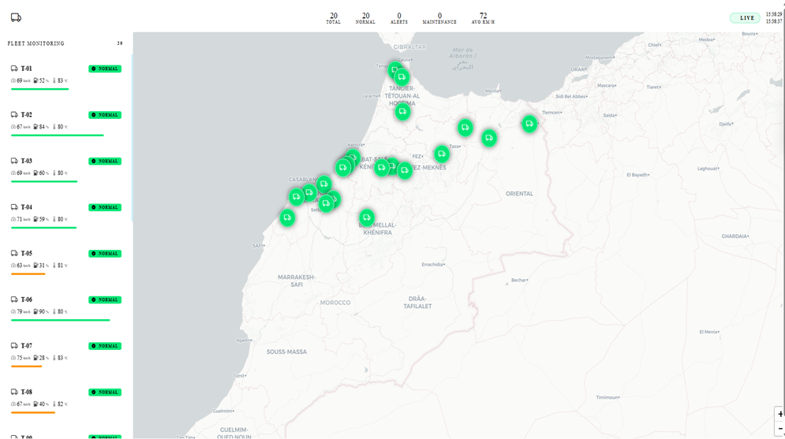
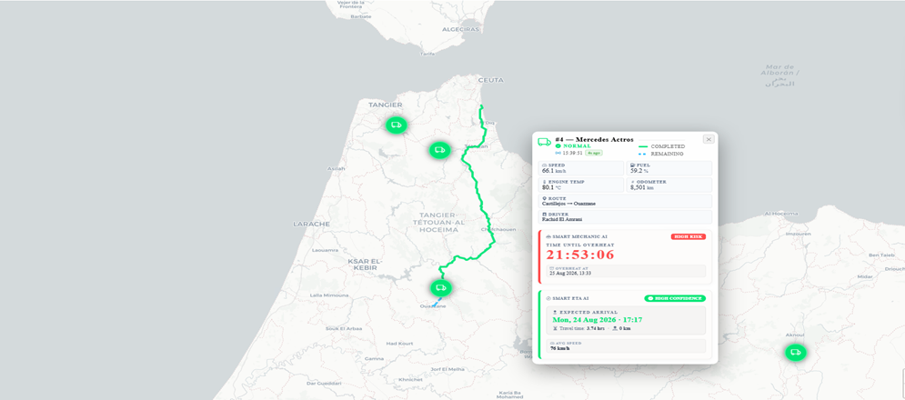
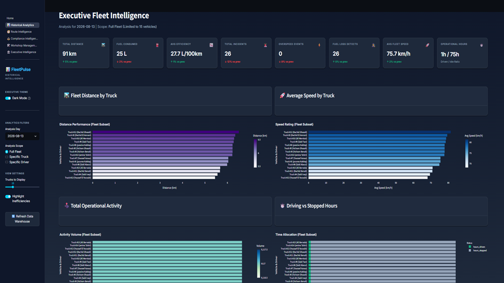
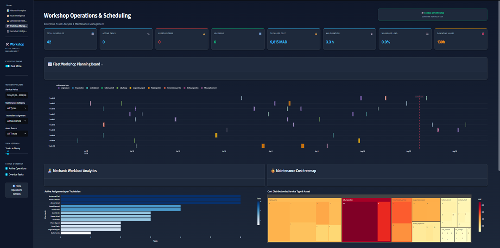
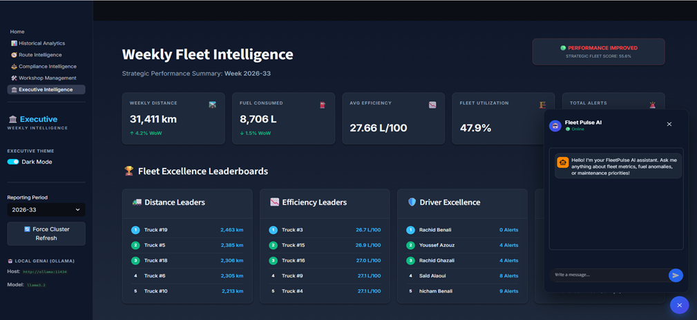

# 🚛 Real-Time Distributed IoT Fleet Monitoring & Analytics Platform

[](https://github.com/)
[](https://kafka.apache.org/)
[](https://spark.apache.org/)
[](https://cassandra.apache.org/)
[](https://ollama.ai/)
[](https://min.io/)
[](https://cloud.google.com/)
[](https://www.docker.com/)
[](https://angular.io/)
[](https://streamlit.io/)

An enterprise-grade, distributed IoT Big Data platform for real-time fleet telemetry ingestion, anomaly detection, predictive machine learning maintenance, LLM-powered executive assistance (RAG Chatbot), and multi-layer analytics. Built using high-throughput event streaming (Kafka), distributed stream processing (Spark Structured Streaming), hybrid storage (NoSQL Cassandra Speed Layer + MinIO/GCS Parquet Data Lake), local GenAI (Ollama/Llama 3.2), and interactive web dashboards.

---

## 📸 System Architecture & Technical Blueprint

### 🏗️ Global Platform Architecture (Lambda Pattern)
- La plateforme repose sur une Architecture Lambda, un pattern architectural Big Data qui combine deux chemins de traitement complémentaires pour répondre à la fois aux besoins de réactivité temps réel et de richesse analytique historique.




### 🌊 Dual-Sink Data Lake Flow (Kafka ➔ Spark ➔ Cassandra & MinIO S3)


### 🤖 Local RAG Executive Chatbot Architecture (Ollama + LangChain + Cassandra)

- Le chatbot exécutif intégré dans la plateforme repose sur une architecture RAG (Retrieval Augmented Generation). Cette approche combine la puissance de génération de texte du LLM avec la récupération de données réelles et actualisées depuis Cassandra.

- Le pipeline RAG fonctionne en trois étapes :
  -	Retrieval : Récupération des contextes pertinents depuis les tables Cassandra (résumés hebdomadaires, statistiques journalières, anomalies carburant, flags de maintenance, efficacité des routes).
  -	Augmentation : Construction d'un prompt enrichi combinant les instructions système, le contexte de données formaté en Markdown, et la question de l'utilisateur.
  -	Generation : Envoi du prompt complet au modèle Llama 3.2 via Ollama et streaming de la réponse analytique vers l'interface utilisateur.




---

## 🖼️ User Interfaces & Command Centers

### 1️⃣ Real-Time Operational Fleet Command Center (Angular 17 + Leaflet)
- Située dans application/frontend, cette application offre une carte de contrôle opérationnelle :
  -	``Carte interactive Leaflet`` : Marqueurs de camions animés en temps réel avec orientation selon le cap GPS et couleur selon le statut (Vert = Normal, Rouge = Alerte).
  -	``Sidebar ergonomique`` : Recherche par véhicule, jauges de vitesse (km/h), niveau de carburant (%) et température (°C) avec défilement fluide.
  -	``Panneau d'alertes instantanées`` : Notification visuelle dès qu'un événement OVERSPEED ou OVERHEAT survient.





*Real-time vehicle position tracking, live telemetry gauges (Speed, Engine Temp, Fuel Level), and instant anomaly notification triggers (OVERSPEED & OVERHEAT).*

### 2️⃣ Route Intelligence & Analytics Dashboard (Streamlit v2)
- Développée dans processing/streamlit_v2, l'application Streamlit propose plusieurs volets décisionnels :

  -	Supervision Directe & Corridors : Cartographie des routes commerciales et histogrammes Plotly de consommation par transporteur.



*Geospatial route corridors, speed compliance heatmaps, and carrier consumption benchmarks.*

### 3️⃣ Executive Intelligence & Conversational RAG Chatbot Modal
-	Executive Intelligence & Chatbot RAG :
    -	Floating Action Button (bouton circulaire bleu en bas à droite 💬).
    -	Modal flottant (390px) intégrant un assistant conversationnel RAG.
    -	Modèle LLM Llama 3.2 exécuté localement via Ollama sur http://ollama:11434.
    -	Interrogation directe du contexte Cassandra (batch_weekly_summary, batch_maintenance_flags, batch_route_efficiency).



*Executive dashboard with floating 💬 RAG Chatbot modal running local Llama 3.2 via Ollama to query live Cassandra analytics context without cloud egress.*

---

## ✨ Key Features & Technical Highlights

### ⚡ Speed Layer (Real-Time Ingestion & Streaming)
- **High-Throughput IoT Telemetry**: Ingests multi-vehicle streams ($100-500$ heavy trucks) every 2–5 seconds via Apache Kafka.
- **Complex Event Processing (CEP)**: Apache Spark Structured Streaming cleans, validates schema, and computes rolling time windows ($<1.8\text{s}$ latency).
- **Instant Anomaly Detection**: Real-time evaluation of:
  - **Overspeed**: $>120\text{ km/h}$
  - **Overheating**: Engine temp $>105^\circ\text{C}$
  - **Sudden Fuel Drop**: Potential fuel theft detection
- **Resilient Dual-Sink Pattern**:
  - **Cassandra Sink (2s trigger)**: Immediate writes to `real_time_truck_data` & `real_time_alerts`.
  - **MinIO S3 Data Lake Sink (5m trigger)**: Micro-batch append of partitioned Parquet files (`event_date=YYYY-MM-DD`).

### ⚙️ Batch Layer & Predictive Machine Learning
- **Remaining Useful Life (RUL) Maintenance Model**:
  - **Feature Engineering**: Rolling windows over 20 telemetry events (`avg_temp_window`, `stddev_temp_window`, `avg_speed_window`).
  - **Algorithm**: `RandomForestRegressor` (20 decision trees) trained with PySpark MLlib.
  - **Validation & Promotion**: Automatic quality gate requiring $\ge 90\%$ accuracy before promoting to production.
  - **Inference**: Categorizes trucks into `HIGH` (RUL $<24\text{h}$), `MEDIUM` (RUL $<72\text{h}$), or `LOW` priority queues.
- **Corridor ETA Prediction Model**:
  - **Trip Aggregation**: Computes duration, departure hour (`hour_of_day`), day of week (`day_of_week`), and average corridor speed.
  - **Algorithm**: `GBTRegressor` (Gradient-Boosted Trees).
  - **Validation Threshold**: Frozen into production only when $\text{RMSE} < 2.0\text{ hours}$.
- **Scheduled Orchestration**: Apache Airflow DAGs automate daily stats, weekly summaries, traffic violations, and ML retraining.

### 🤖 Local GenAI Executive Chatbot (RAG)
- **Zero-Cloud Egress**: Containerized **Ollama** running `llama3.2` / `qwen2.5` locally.
- **LangChain RAG Pipeline**: Connects LLM directly to Cassandra analytical views (`batch_weekly_summary`, `batch_maintenance_flags`, `batch_route_efficiency`).
- **Floating UI Integration**: Embedded modal with circular trigger button on Streamlit Executive view.

---

## 🛠️ Technology Stack

| Domain | Technology / Tool | Purpose & Usage |
| :--- | :--- | :--- |
| **Generative AI & LLM** | Ollama, Llama 3.2, Qwen 2.5, LangChain | Local RAG Chatbot for conversational fleet intelligence |
| **Machine Learning** | PySpark MLlib (`RandomForest`, `GBTRegressor`) | RUL predictive maintenance & Corridor ETA prediction models |
| **Data Generation** | Python 3.11, Faker, Custom GPS Engine | Multi-truck telemetry simulator ($100-500$ trucks) with anomaly injection |
| **Event Ingestion** | Apache Kafka (KRaft mode), Zookeeper | High-throughput message broker ($>800\text{ msgs/sec}$) |
| **Stream Processing** | Apache Spark Structured Streaming | Real-time cleaning, CEP, and dual-sink write processor |
| **Batch Orchestration** | Apache Airflow 3.x, PySpark Batch | Automated execution of daily aggregations and ML pipelines |
| **Speed Storage** | Apache Cassandra (NoSQL) | Low-latency time-series queries for live telemetry & alerts |
| **Data Lake** | MinIO S3 / Google Cloud Storage (GCS) | Parquet format storage partitioned by `event_date` |
| **Data Warehouse** | Google BigQuery | Cloud OLAP warehouse for historical BI analytics |
| **Real-Time Web UI** | Angular 17, Leaflet.js, RxJS | Live map tracking, dynamic gauges, and instant alert popups |
| **Analytics Web UI** | Streamlit v2, PyDeck, Plotly | Route intelligence, carrier metrics, and executive dashboard |
| **Database Migration** | Flyway 10.x | Automated CQL schema migrations (`V1__...` to `V14__...`) |
| **Containerization** | Docker Engine, Docker Compose v2 | Microservices container isolation & service discovery |
| **DevOps & Mesh** | GNU Make, PowerShell, NetBird VPN | Single-command cluster management & secure remote LLM mesh |

---

## 📁 Repository Structure

```text
.
├── application/                # Application Services & Frontends
│   ├── backend/                # FastAPI REST API (Telemetry & Truck Endpoints)
│   ├── frontend/               # Angular 17 + Leaflet Real-Time Map Application
│   ├── simulators/             # Multi-truck IoT Telemetry Simulator
│   └── docker-compose.yml      # Docker compose for application stack
├── db/                         # Database Schema & Migrations
│   ├── migration/              # Flyway CQL Schema Migrations (V1__ to V14__)
│   ├── Dockerfile              # Custom Flyway runner image
│   └── pom.xml                 # Flyway Maven dependencies
├── processing/                 # Stream & Batch Processing Engines
│   ├── speed_layer_2/          # Spark Structured Streaming Dual-Sink Processor
│   ├── batch_layer_2/          
│   │   ├── spark_jobs/         # PySpark Jobs (Daily Stats, RUL ML, ETA ML)
│   │   └── airflow/            # Airflow DAGs for Pipeline Orchestration
│   └── streamlit_v2/           # Streamlit Analytics UI & Executive RAG Chatbot
├── tools/                      # Infrastructure Services
│   └── docker-compose.yml      # Kafka, Cassandra, MinIO, Spark, Ollama
├── readme_assets/              # Architecture Diagrams & UI Screenshots from Report
├── Makefile                    # Unified Cluster Management Commands
├── .env.example                # Environment Configuration Template
└── readme.md                   # Platform Documentation
```

---

## 🚀 Quick Start & Deployment Guide

### Prerequisites
Ensure your environment has:
- **Docker Engine** (v24.x+) & **Docker Compose** (v2.x+)
- **GNU Make** (or PowerShell on Windows)
- **Python 3.11+**

---

### 1️⃣ Environment Setup

```bash
cp .env.example .env.dev
```

---

### 2️⃣ Start Full Platform with Makefile

```bash
# Start all infrastructure, stream processor, batch layer, and apps
make up
```

Or start components individually:

```bash
# 1. Start core tools (Kafka, Cassandra, MinIO, Spark, Ollama)
make tools

# 2. Start Spark Structured Streaming (Speed Layer)
make speed

# 3. Start Airflow Batch Scheduler
make batch

# 4. Start Simulators, Backend API, Angular & Streamlit UIs
make app
```

---

### 3️⃣ Active Service Endpoints

| Service | Container | Access URL / Port | Health Check |
| :--- | :--- | :--- | :--- |
| **Angular Real-Time UI** | `angular-app` | `http://localhost:80` | Nginx 200 OK |
| **Streamlit Analytics & Chatbot** | `streamlit` | `http://localhost:8501` | Active |
| **FastAPI Backend Service** | `backend` | `http://localhost:8000/docs` | `/health` OK |
| **Apache Airflow Webserver** | `airflow` | `http://localhost:8080` | `airflow` / `airflow` |
| **Ollama Local GenAI API** | `ollama` | `http://localhost:11434` | `/api/tags` OK |
| **MinIO S3 Console** | `minio` | `http://localhost:9001` | Live |
| **Spark Master UI** | `spark-master` | `http://localhost:8084` | Active |

---

## 👤 Author & Academic Context

- **Author**: Mohamed Amine Azouz
- **Program**: DCESS Ingénierie Informatique – **ENSA Tanger**
- **Company / Host**: EIN CONSULTING
- **GitHub**: [@MohamedAmineAzouz](https://github.com/MohamedAmineAzouz)

---

## 📄 License

This project is licensed under the MIT License - see the [LICENSE](LICENSE) file for details.
